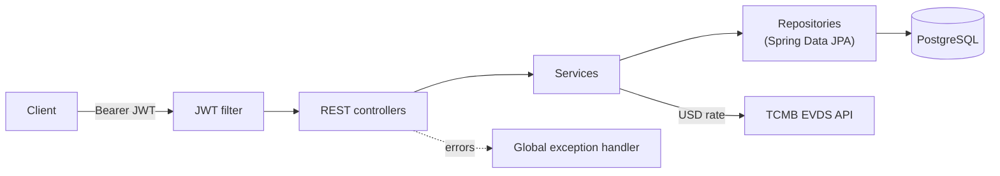
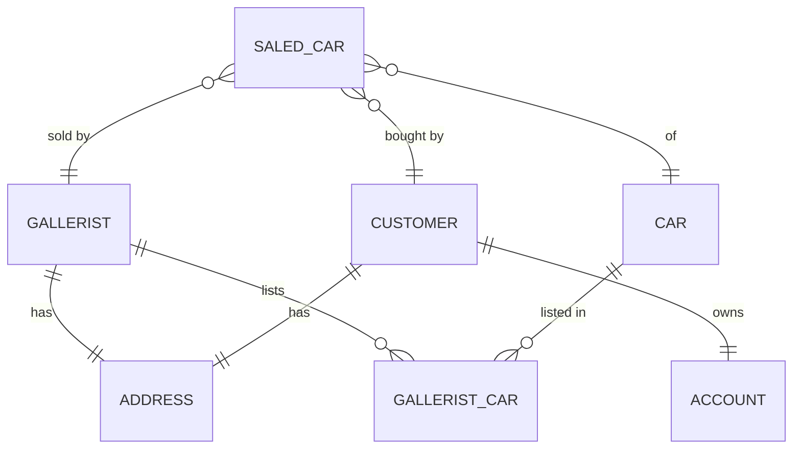

# 🚘 Gallerist — Car Dealership Management API

A REST API for managing a car dealership: galleries, their cars, customers, bank accounts and car sales. Built with **Spring Boot**, secured with **JWT + refresh tokens**, and connected to the **Central Bank of the Republic of Türkiye (TCMB EVDS)** API for live USD exchange rates used in sales.

## ✨ Features
- **JWT authentication** — register, login, short-lived access token (2h) and refresh token (4h) flow
- **Dealership domain** — galleries, cars, customers, addresses and bank accounts with relationships
- **Car sale workflow** — checks that the car is not already sold, converts the customer's balance to USD using the live TCMB rate, verifies the balance covers the price, then marks the car as sold and updates the balance
- **Live exchange rates** — consumes the TCMB EVDS REST API
- **Global exception handling** — custom `BaseException`, typed error messages and a unified `ApiError` response
- **Validation** on incoming DTOs and a clean controller → service → repository layering

## 🏗️ Architecture



### Domain model



## 🔌 API

| Method | Endpoint | Description |
|---|---|---|
| POST | `/register` | Create a user |
| POST | `/authenticate` | Login, returns access + refresh token |
| POST | `/refreshToken` | Get a new access token |
| POST | `/rest/api/address/save` | Create an address |
| POST | `/rest/api/account/save` | Create a bank account |
| POST | `/rest/api/customer/save` | Create a customer |
| POST | `/rest/api/gallerist/save` | Create a gallery |
| POST | `/rest/api/car/save` | Create a car |
| POST | `/rest/api/gallerist-car/save` | Assign a car to a gallery |
| POST | `/rest/api/saled-car/save` | Sell a car to a customer |
| GET | `/rest/api/currency-rates` | Current USD exchange rate |

All endpoints except `/register`, `/authenticate` and `/refreshToken` require a `Bearer` token.

## 🛠️ Tech Stack
Java · Spring Boot · Spring Security · JWT (jjwt) · Spring Data JPA · PostgreSQL · Bean Validation · Lombok · Maven

## 🚀 Getting Started

Get a free API key from [TCMB EVDS](https://evds2.tcmb.gov.tr), then:

```bash
cd gallerist-backend
export TCMB_API_KEY=your_evds_key
./mvnw spring-boot:run
```

Configure the database in `src/main/resources/application.properties` (PostgreSQL, schema `gallerist`).
